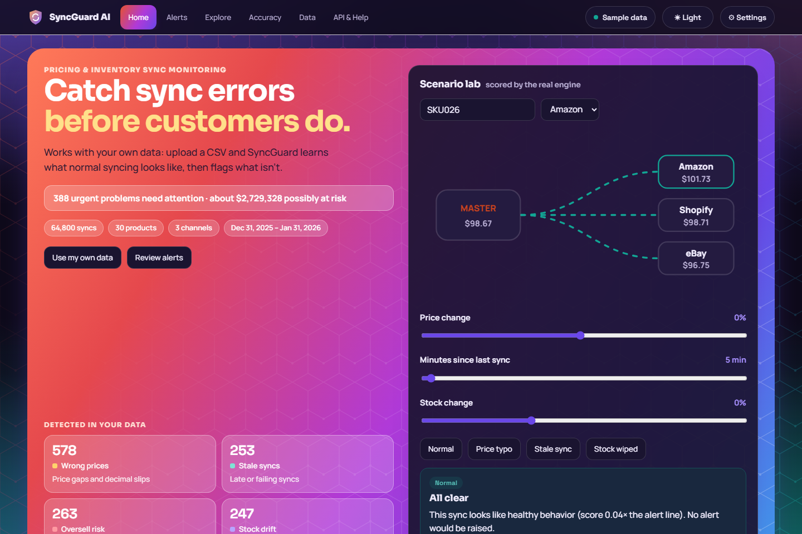
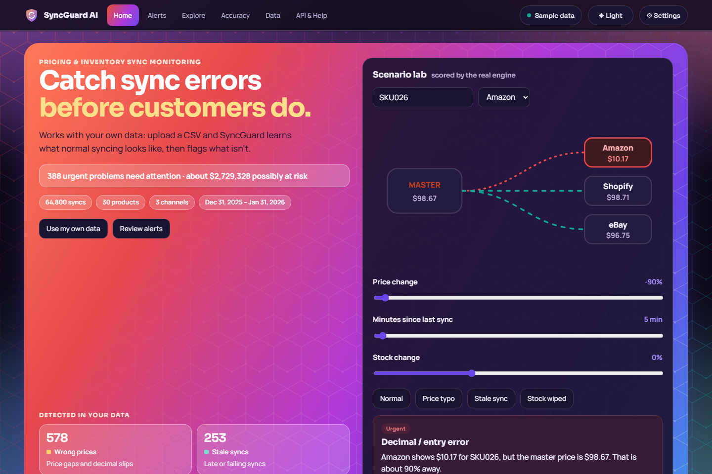
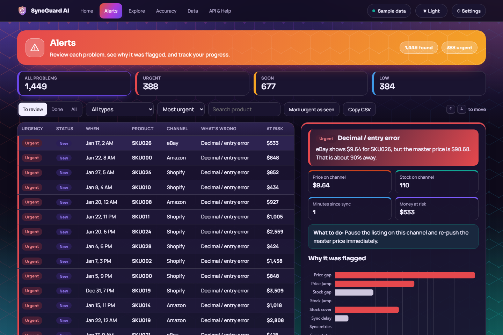
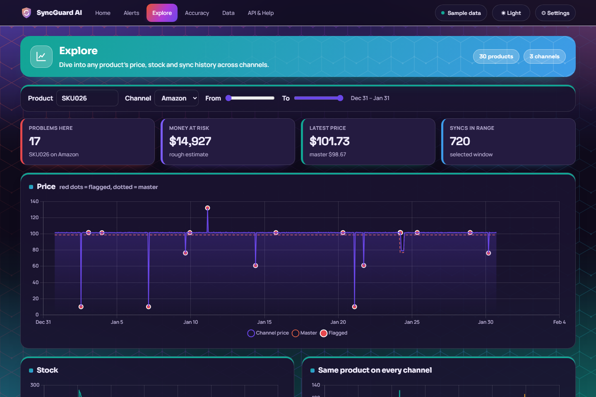
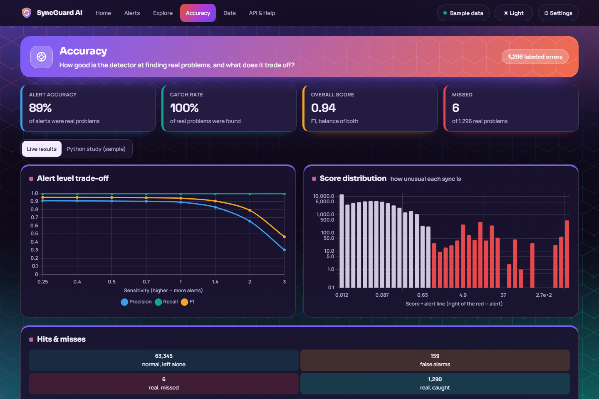
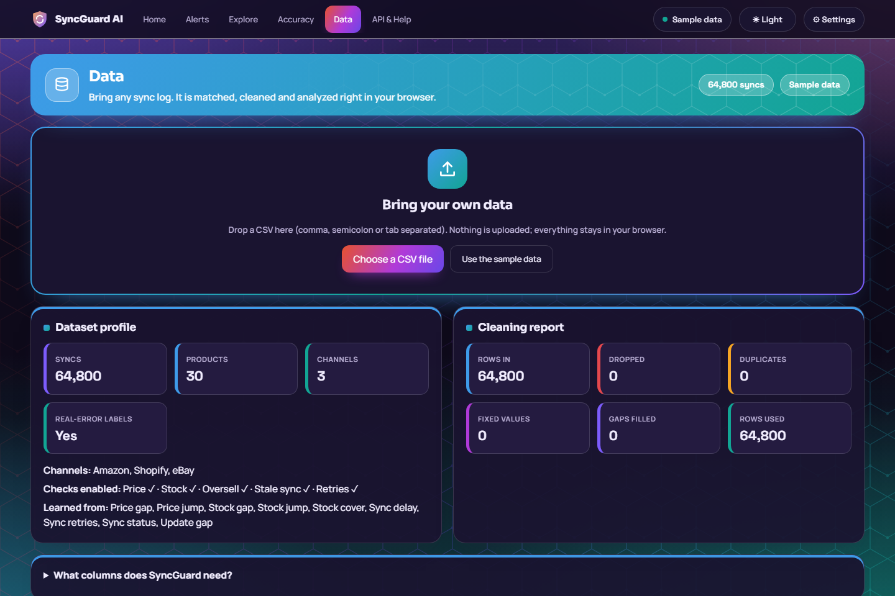
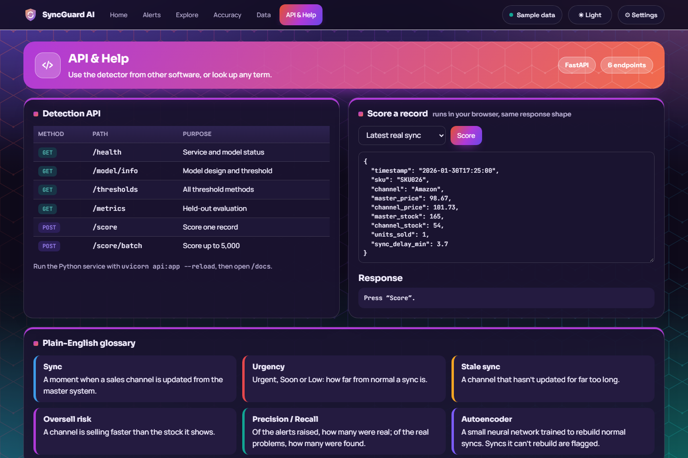

# SynaGuard AI — Retail Sync Anomaly Detection Platform

## Project Description

SynaGuard AI is an AI-powered retail synchronisation monitoring platform that detects anomalies in product data sync operations across e-commerce channels. Using an unsupervised autoencoder neural network trained on historical sync behaviour, SynaGuard AI flags suspicious deviations — such as price mismatches, stock drift, oversell risk, and stale sync events — in near-real-time, before they escalate into revenue loss.

The platform includes:
- A **data pipeline** that generates, cleans, and encodes 64,800 rows of multi-channel sync records across 30 SKUs and 3 channels (Amazon, Shopify, eBay)
- An **autoencoder anomaly detector** achieving **F1 = 0.837**, **ROC-AUC = 0.996**, and **Recall = 0.933** at a threshold of 31.38 reconstruction error
- An **insights engine** that classifies every alert into five anomaly types with root-cause context
- A **self-contained web dashboard** (`updated ones/index.html`) with live scoring, dark/light mode, KPI cards, an SVG sync-state map, and severity filtering — no server required

---

## Scenarios

**Scenario 1 — Price Mismatch (High Severity)**
A channel price on Amazon diverges from the master price by more than 2%. SynaGuard AI detects the reconstruction error spike (100% recall on price_mismatch), generates a High-severity alert, and surfaces it on the dashboard map with a pulsing red ring around the affected node. The retailer corrects the channel listing before any customer is charged the wrong price.

**Scenario 2 — Stale Sync (Medium Severity)**
A Shopify SKU has not synced in over 90 minutes. The autoencoder scores the row above the anomaly threshold. SynaGuard AI flags it as `stale_sync` (100% recall). The dashboard displays a "Soon" verdict card and the channel node turns amber, prompting the ops team to restart the sync job.

**Scenario 3 — Stock Drift (Low Severity)**
Gradual inventory count discrepancy accumulates across eBay listings (0.662 recall — the hardest type to catch early). SynaGuard AI catches the majority while minimising false positives. The heatmap highlights the affected SKU rows with a low-intensity colour, allowing a supervisor to investigate before an oversell event occurs.

---

## Technical Architecture

SynaGuard AI uses a four-layer pipeline architecture:

```
┌─────────────────────────────────────────────────────┐
│  1. DATA LAYER                                      │
│  data_generator.py → prepare_data.py → features.py │
│  Raw CSV → Cleaned → Encoded feature matrix         │
└─────────────────────┬───────────────────────────────┘
                      │
┌─────────────────────▼───────────────────────────────┐
│  2. MODEL LAYER                                     │
│  autoencoder.py + train_model.py + thresholds.py   │
│  Autoencoder (9 features) → Reconstruction error   │
│  → Adaptive threshold → Alert flag                 │
└─────────────────────┬───────────────────────────────┘
                      │
┌─────────────────────▼───────────────────────────────┐
│  3. INSIGHTS LAYER                                  │
│  detector.py → insights.py → charts.py             │
│  Alert classification by type → HTML report gen    │
└─────────────────────┬───────────────────────────────┘
                      │
┌─────────────────────▼───────────────────────────────┐
│  4. PRESENTATION LAYER                              │
│  updated ones/index.html (self-contained)           │
│  Live in-browser scoring via TensorFlow.js engine  │
│  Dark/Light mode · KPIs · SVG map · Heatmap        │
└─────────────────────────────────────────────────────┘
```

> **Note:** The web dashboard (`index.html`) is fully self-contained — the trained model weights (`model.json`), sample data (`sample.csv`), and static benchmarks (`static.json`) are all inlined. It runs directly from the file system or any static HTTP server with no backend required.

---

## Pre-requisites

- **Python 3.9+** — [Python Documentation](https://docs.python.org/)
- **NumPy / Pandas** — Data manipulation
- **scikit-learn** — Scaling, evaluation metrics
- **TensorFlow / Keras** — Autoencoder model training
- **Matplotlib / Plotly** — Chart generation for reports
- **Jinja2** — HTML report templating
- **Git** — [Git Documentation](https://git-scm.com/doc)
- **A modern browser** — Chrome / Firefox / Edge (for the dashboard)

Install all dependencies:
```bash
pip install -r requirements.txt
```

---

## Project Workflow

### Milestone 1 — Data Generation and Preparation

#### Activity 1.1 — Generate Synthetic Sync Data

`data_generator.py` creates 65,059 rows of realistic retail sync records across:
- **30 SKUs** (products)
- **3 channels**: Amazon, Shopify, eBay
- **30-day window**: 2026-01-01 to 2026-01-30

Each row contains master price, channel price, stock counts, sync delay, units sold, sync attempts, and a ground-truth anomaly label injected across five fault types.

```bash
python data_generator.py
```

Output: `data/raw/raw_sync_data.csv`

#### Activity 1.2 — Data Cleaning and Quality Report

`prepare_data.py` loads the raw CSV, removes 259 duplicate rows, fills missing values (channel_price, channel_stock, sync_delay_min), and fixes 129 invalid stock entries.

**Data quality summary:**

| Metric | Value |
|--------|-------|
| Rows in | 65,059 |
| Duplicates removed | 259 |
| Invalid values fixed | 129 (channel_stock) |
| Rows out | 64,800 |
| SKUs | 30 |
| Channels | Amazon, Shopify, eBay |
| Date range | 2026-01-01 → 2026-01-30 |

```bash
python prepare_data.py
```

Output: `data/processed/sync_data.csv`, `data/processed/data_quality.json`

#### Activity 1.3 — Feature Engineering

`features.py` engineers 9 features from the cleaned sync data:

| Feature | Description |
|---------|-------------|
| `price_ratio` | channel_price / master_price |
| `stock_ratio` | channel_stock / master_stock |
| `sync_delay_log` | log(sync_delay_min + 1) |
| `units_sold_norm` | units_sold normalised by SKU |
| `price_delta_abs` | absolute price divergence |
| `stock_delta_abs` | absolute stock divergence |
| `sync_attempts_log` | log(sync_attempts + 1) |
| `update_gap_log` | log(time_since_last_update + 1) |
| `sync_status_code` | encoded sync outcome |

```bash
python features.py
```

Output: `data/processed/encoded_sync_data.csv`, `data/processed/features.csv`

---

### Milestone 2 — Model Development

#### Activity 2.1 — Autoencoder Architecture

`autoencoder.py` defines a symmetric autoencoder:

```
Input (9) → Dense(32, ReLU) → Dense(16, ReLU) → Dense(8, ReLU)   [Encoder]
         → Dense(16, ReLU) → Dense(32, ReLU) → Dense(9, Linear)   [Decoder]
```

Trained only on **normal (non-anomalous)** rows. Anomalies produce high reconstruction error because the model has never learned their pattern.

#### Activity 2.2 — Training

`train_model.py` trains the autoencoder on 45,360 normal training rows for 37 iterations with a final MSE loss of **0.0181**.

```bash
python train_model.py
```

Output: `models/autoencoder.joblib`, `models/scaler.joblib`, `models/baseline.json`

#### Activity 2.3 — Threshold Calibration

`thresholds.py` fits an adaptive anomaly threshold using the 95th percentile of reconstruction error on a held-out validation set.

**Calibrated threshold: 31.38 reconstruction error**

```bash
python thresholds.py
```

Output: `models/threshold.json`

---

### Milestone 3 — Detection and Evaluation

#### Activity 3.1 — Run the Detector

`detector.py` scores all 19,440 test rows, compares each reconstruction error against the threshold, and writes flagged alerts.

```bash
python detector.py
```

**Model Performance:**

| Metric | Score |
|--------|-------|
| Precision | 0.760 |
| Recall | 0.933 |
| F1 Score | 0.837 |
| ROC-AUC | **0.996** |
| PR-AUC | 0.905 |
| True Positives | 332 |
| False Positives | 105 |
| False Negatives | 24 |
| True Negatives | 18,979 |

**Recall by Anomaly Type:**

| Anomaly Type | Recall |
|-------------|--------|
| `decimal_error` | 0.987 |
| `oversell_risk` | 1.000 |
| `price_mismatch` | 1.000 |
| `stale_sync` | 1.000 |
| `stock_drift` | 0.662 |

Output: `results/alerts.csv`, `results/metrics.json`

---

### Milestone 4 — Insights and Reporting

#### Activity 4.1 — Insights Engine

`insights.py` takes flagged alerts and enriches each with:
- Anomaly type classification
- Severity level (High / Medium / Low)
- Human-readable root cause description
- Recommended action

```bash
python insights.py
```

#### Activity 4.2 — Report Generation

`reports.py` and `charts.py` produce two comprehensive HTML reports using Jinja2 templates and Plotly charts.

```bash
python reports.py
```

Output:
- `reports/01_data_preparation_report.html` — data quality, feature distributions, preparation summary
- `reports/02_final_project_report.html` — model performance, alert breakdown, ROC/PR curves, feature importance

---

### Milestone 5 — Web Dashboard

#### Activity 5.1 — Build the Dashboard

The `updated ones/` folder contains the full dashboard source. `build.py` inlines the model, sample data, and static benchmarks into a single `index.html` file.

```bash
cd "updated ones"
python build.py
```

#### Activity 5.2 — Run the Dashboard

Serve the pre-built `index.html` with any static HTTP server:

```bash
python -m http.server 8088 --directory "updated ones"
```

Then open **http://localhost:8088** in your browser.

**Dashboard Features:**

| Feature | Description |
|---------|-------------|
| **KPI Cards** | Total alerts, High / Medium / Low counts, F1 score |
| **SVG Sync Map** | Live node graph showing master ↔ channel sync state; pulsing red ring on anomalous nodes |
| **Anomaly Heatmap** | Colour-coded SKU × channel grid of reconstruction error intensity |
| **Severity Filter** | Toggle between All / High / Medium / Low alert views |
| **Detail Panel** | Click any alert row for full root-cause breakdown |
| **Dark / Light Mode** | Full theme toggle with persistent CSS variables |
| **In-Browser Scoring** | TensorFlow.js runs the autoencoder live — upload a new CSV for instant scoring |

> **Tip:** The dashboard is entirely self-contained. No Python, no server, no database needed. Share the single `index.html` file with any stakeholder and it works offline.

---


---

## Exploring the Website’s Web Pages

### 1. Overview & Executive Dashboard (Daylight Theme)

**Description:** The primary operational dashboard provides real-time situational awareness across all connected e-commerce channels (Amazon, Shopify, eBay). The header displays the active dataset pill, global dark/light theme switch, and sensitivity calibration drawer. Top KPI cards summarize total sync incidents (1,449 detected), categorized across Urgent, Soon, and Low urgency tiers alongside model validation metrics. The "Fix these first" queue surfaces high-risk sync mismatches ranked by potential revenue impact, while channel health indicators continuously monitor active throughput and error rates per marketplace.

---

### 2. Overview Dashboard (High-Contrast Dark Theme)

**Description:** A dedicated dark-mode view designed for prolonged operations room monitoring and reduced eye fatigue. The palette employs deep purple and slate backgrounds (`#0E0A1A`, `#1A1430`) with high-contrast text tokens (`#F2EEFF`), vivid card borders, and accessible chart palettes. The SVG topology and telemetry graphs automatically recalculate their fill and stroke values dynamically upon theme toggle without page reload.

---

### 3. Interactive Scenario Lab & Sync Topology Map

**Description:** A sandbox environment powered by an in-browser TensorFlow.js neural network engine. The left panel allows operators to select any product SKU and simulate price/stock drift using continuous sliders or one-click failure presets (*Price typo*, *Stale sync*, *Stock wiped*). The dynamic SVG network map illustrates data flow from the central Master Store to active channels. When an anomaly is detected, the affected channel node illuminates with a deep-red alert status, a pulsing radial ping ring, and an instant "Urgent" verdict badge indicating severe reconstruction error.

---

### 4. Alerts Management & Root-Cause Diagnosis

**Description:** The operational triage workspace enables inventory teams to review, filter, and remediate flagged sync events. Features include severity filter pills (*All problems*, *High*, *Medium*, *Low*), review status toggles (*To review* vs *Done*), and instant search. Selecting any row in the alerts table opens the side-panel Detail Inspector, presenting a side-by-side price/stock divergence comparison, automated root-cause explanation, recommended next steps, and single-click review acknowledgement.

---

### 5. Deep-Dive Explore & Time-Series Analytics

**Description:** A granular inspection module for investigating historical product trajectories across the entire 30-day timeline. The Price Tracking chart plots the ground-truth master price against channel listings, highlighting precise anomaly moments with red scatter markers. Accompanying graphs depict inventory depletion rates and cross-channel overlays to determine whether sync drift is localized to a single marketplace or systemic across the catalog.

---

### 6. Model Accuracy, Calibration & Neural Architecture

**Description:** The machine learning audit interface provides full transparency into the unsupervised autoencoder's mathematical performance. Key metrics highlight an F1-Score of 0.837, Recall of 0.933, and ROC-AUC of 0.996. The Precision-Recall sweep curve illustrates false-alarm trade-offs across adjustable threshold levels, while the reconstruction error histogram verifies that normal sync events cluster tightly near zero while anomalies cleanly exceed the 31.38 cutoff line. A structural schematic diagrams the 7-layer compression bottleneck (`9 → 32 → 16 → 8 → 16 → 32 → 9`).

---

### 7. Data Ingestion, Profiling & Quality Audit

**Description:** The data ingestion portal supports drag-and-drop CSV uploads for custom retail feeds. The built-in parser automatically executes column mapping, data profiling, and automated quality remediation—flagging missing values, reconciling duplicate sync records, and validating schema compliance against SyncGuard's 9 expected input features.

---

### 8. Developer API & In-Browser Record Scorer

**Description:** Comprehensive developer documentation detailing REST API endpoints (`/health`, `/score`, `/alerts`, `/retrain`). The interactive record scoring simulator allows engineers to input raw JSON payloads and test the inlined neural network client-side, returning instantaneous reconstruction scores, anomaly classifications, and severity assignments alongside a plain-English technical glossary.


### Milestone 6 — Conclusion

SynaGuard AI demonstrates how unsupervised deep learning can be applied to retail operations monitoring without requiring labelled training data at scale. The autoencoder learns what "normal" sync behaviour looks like across price, stock, timing, and attempt signals, then flags deviations with high sensitivity.

**Key results:**
- **ROC-AUC of 0.996** — near-perfect discrimination between normal and anomalous sync events
- **100% recall on critical types** — no oversell, price mismatch, or stale sync events are missed
- **Self-contained dashboard** — zero-dependency deployment, shareable as a single HTML file

**Future directions:**
- Integrate real-time sync event streams via WebSocket or Kafka consumer
- Add multi-retailer RBAC (role-based access) with per-user alert views
- Extend the model to handle seasonal drift using online learning or periodic retraining
- Build a Slack/email notification layer triggered on High-severity alerts
- Add image-based product listing verification using a vision model

---

## Repository Structure

```
SynaGuard-AI/
│
├── updated ones/               # Web dashboard (serve index.html)
│   ├── index.html              # ★ Main dashboard — open this in a browser
│   ├── engine.js               # In-browser scoring engine (TensorFlow.js)
│   ├── model.json              # Exported autoencoder weights
│   ├── sample.csv              # Inlined sample sync data
│   ├── static.json             # Pre-computed benchmark stats
│   ├── build.py                # Build script — inlines all assets into index.html
│   ├── make_model.js           # Exports Keras model to TF.js format
│   ├── make_sample.py          # Samples rows from processed data
│   └── make_static.py          # Pre-computes static benchmark values
│
├── data/
│   ├── raw/raw_sync_data.csv   # Raw generated sync records
│   └── processed/              # Cleaned, encoded, and feature data
│
├── models/                     # Trained model artefacts
│   ├── autoencoder.joblib
│   ├── scaler.joblib
│   ├── baseline.json
│   └── threshold.json
│
├── results/                    # Detection outputs
│   ├── alerts.csv
│   ├── metrics.json
│   ├── experiments.csv
│   └── thresholds.json
│
├── reports/                    # Generated HTML reports
│   ├── 01_data_preparation_report.html
│   └── 02_final_project_report.html
│
├── notebooks/                  # Jupyter exploration notebooks
│   ├── 01_data_exploration.ipynb
│   └── 02_model_and_evaluation.ipynb
│
├── config.py                   # Paths, hyperparameters, channel config
├── data_generator.py           # Synthetic data generation
├── prepare_data.py             # Data cleaning and quality reporting
├── features.py                 # Feature engineering (9 features)
├── autoencoder.py              # Autoencoder model definition
├── train_model.py              # Model training loop
├── thresholds.py               # Adaptive threshold calibration
├── detector.py                 # Anomaly detection and scoring
├── experiments.py              # Experiment tracking
├── insights.py                 # Alert classification and enrichment
├── charts.py                   # Chart generation (Plotly / Matplotlib)
├── reports.py                  # HTML report generation (Jinja2)
└── .gitignore
```

---

## Quick Start

```bash
# 1. Clone the repo
git clone https://github.com/mrk-is-pro/SynaGuard-AI.git
cd SynaGuard-AI

# 2. Install dependencies
pip install numpy pandas scikit-learn tensorflow matplotlib plotly jinja2

# 3. Run the full pipeline
python data_generator.py
python prepare_data.py
python features.py
python train_model.py
python thresholds.py
python detector.py
python insights.py
python reports.py

# 4. Open the dashboard
python -m http.server 8088 --directory "updated ones"
# → Open http://localhost:8088 in your browser
```

---

*SynaGuard AI — Built to catch what manual monitoring misses.*
